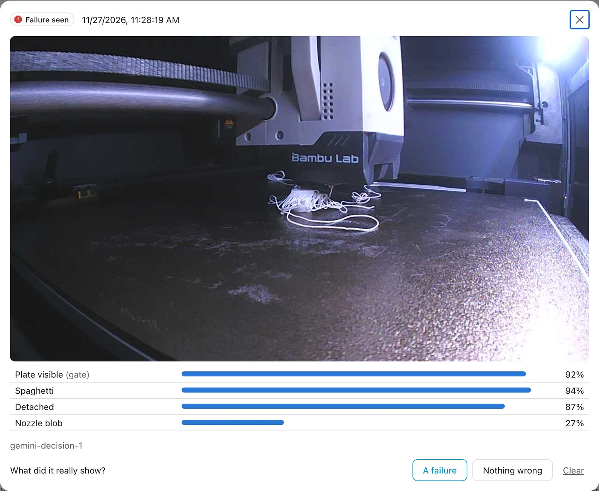
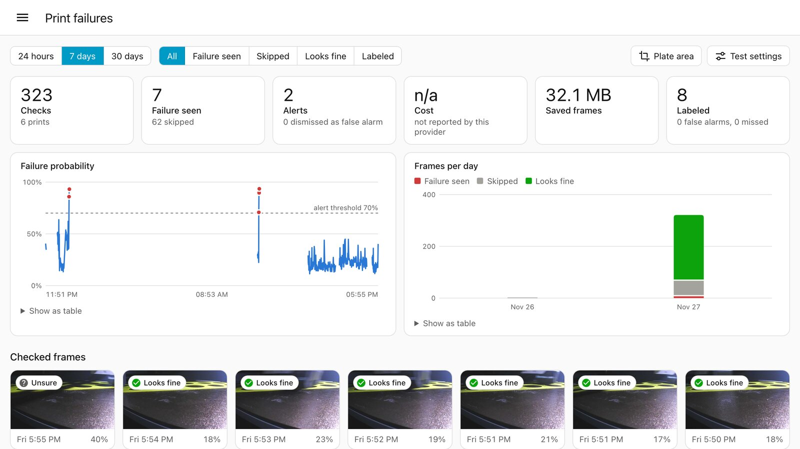

# Print Failure Monitor

A Home Assistant integration that watches a 3D printer's camera during a print and tells you when
it sees spaghetti, a part that came off the plate, or a blob on the nozzle. It can pause the
printer itself, or send a phone notification with Pause, Stop and Continue buttons.

Each check sends a camera frame to an image-capable decision model and asks four yes/no questions:
is the plate visible, is there spaghetti, has the part detached, and is there a blob on the nozzle.
It alerts only when several recent frames agree, so one wrong answer won't interrupt a print.

Any printer with a camera entity and a print status entity in Home Assistant works. The
[printer guide](https://github.com/somus/ha-print-failure-monitor/blob/main/docs/printers.md) lists the entities for Bambu Lab, Klipper (Moonraker),
OctoPrint, PrusaLink, Creality and Elegoo.



The Print failures panel shows every check with its frame, so you can see what the model saw and
label what it got wrong.



## Install

Requires Home Assistant 2026.9 or later.

1. In Home Assistant, open Marketplace (HACS on older versions), open the menu, choose Custom
   repositories, and add `https://github.com/somus/ha-print-failure-monitor` with type
   Integration.
2. Install Print Failure Monitor and restart Home Assistant.
3. Go to Settings > Devices & services > Add integration > Print Failure Monitor.

## Quick start

1. Get an API key. The Gemini API free tier covers a lot of printing, and OpenRouter reaches the
   most models with one key. See [Providers and cost](https://github.com/somus/ha-print-failure-monitor/blob/main/docs/providers.md).
2. Add the integration, name the printer, and enter the provider and key.
3. Pick the camera, the print status entity, and the printer's pause, resume and stop buttons.
   The [printer guide](https://github.com/somus/ha-print-failure-monitor/blob/main/docs/printers.md) has the entity names for each printer integration.
4. Open Print failures in the sidebar, choose Plate area, and drag a box over the plate and the
   space up to the nozzle.
5. Under Configure, choose a notify service such as `notify.mobile_app_your_phone` so alerts reach
   your phone.

Leave auto-pause off for your first few prints and watch the failure probability on healthy ones.
Turn it on once you trust it on your printer.

## Documentation

| Page | What's in it |
|---|---|
| [Setup](https://github.com/somus/ha-print-failure-monitor/blob/main/docs/setup.md) | Setup steps, plate area, camera placement, stage and layer sensors |
| [Printers](https://github.com/somus/ha-print-failure-monitor/blob/main/docs/printers.md) | Entities, paused states and quirks for each printer integration |
| [Checks and alerts](https://github.com/somus/ha-print-failure-monitor/blob/main/docs/alerts.md) | When checks run, notifications and their buttons, print reports, the daily limit |
| [Entities and panel](https://github.com/somus/ha-print-failure-monitor/blob/main/docs/panel.md) | The entities each printer gets, the Print failures panel, labels, frame history |
| [Automations](https://github.com/somus/ha-print-failure-monitor/blob/main/docs/automations.md) | The failure event, the `check` and `snooze` actions, example automations |
| [Tuning](https://github.com/somus/ha-print-failure-monitor/blob/main/docs/tuning.md) | All options, choosing a model, customizing the questions |
| [Providers and cost](https://github.com/somus/ha-print-failure-monitor/blob/main/docs/providers.md) | Supported providers, what a check costs, what gets sent |
| [Troubleshooting](https://github.com/somus/ha-print-failure-monitor/blob/main/docs/troubleshooting.md) | Common problems, diagnostics, debug logging |

## Development

```sh
uv venv -p 3.14 .venv
uv pip install -p .venv/bin/python -r requirements_test.txt
.venv/bin/python -m pytest
uvx ruff check . && uvx ruff format --check .
```

The tests run the integration in a test instance of Home Assistant with the camera and the model
mocked. They cover setup and options validation, each provider's request format, alerting,
auto-pause, notification actions, snoozing, error handling, frame history and cleanup, and the
panel's API and image access.

The panel is a single plain JavaScript file,
`custom_components/print_failure_monitor/frontend/panel.js`, with no build step and no external
requests.
